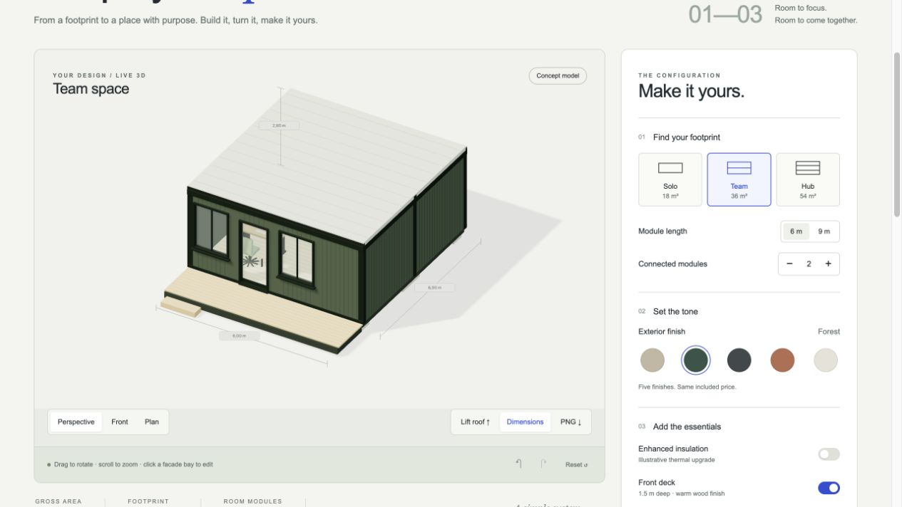

# Modular Studio

**Explore a modular space. See every choice take shape.**

A real-time 3D configurator for small modular buildings. Arrange one to three modules, place doors and windows, explore the interior and export a clear concept summary.



**[Try the live demo](https://mduransu-maker.github.io/modular-studio/)**

## Build a concept

- Choose one to three 3 m wide modules, each 6 m or 9 m long.
- Configure front and rear bays with doors, windows or solid walls.
- Change exterior colors and add a deck, insulation, partitions or furniture.
- Rotate and zoom the 3D view to inspect the result.
- Review an itemized demonstration price as options change.
- Save or load a JSON configuration, capture a PNG image, or print a concept summary to PDF through the browser.

All presets and prices are fictional. The project contains no customer data, company assets or real commercial offers.

## Run locally

With Node.js 22.18 or later:

```sh
npm ci
npm run dev
```

The terminal shows the local address. To verify and build the static site:

```sh
npm run check
npm test
npm run build
npm run preview
```

Built with JavaScript, Three.js and Vite. GitHub Actions checks the model and JavaScript, builds the site and deploys the result to GitHub Pages.

## Scope

This is an interactive product-concept demo, not a CAD tool, engineering calculation, quotation or proof of planning approval. Placement rules illustrate the configurator's own simplified model; they do not establish structural, fire-safety, accessibility, thermal or building-code compliance. Dimensions, furnishings and prices must not be used for procurement or construction.

MIT licensed. Third-party libraries retain their respective licenses.
